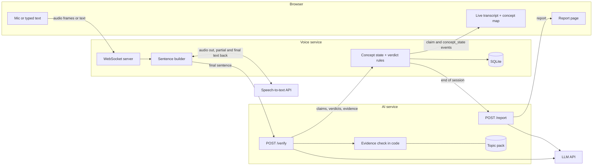
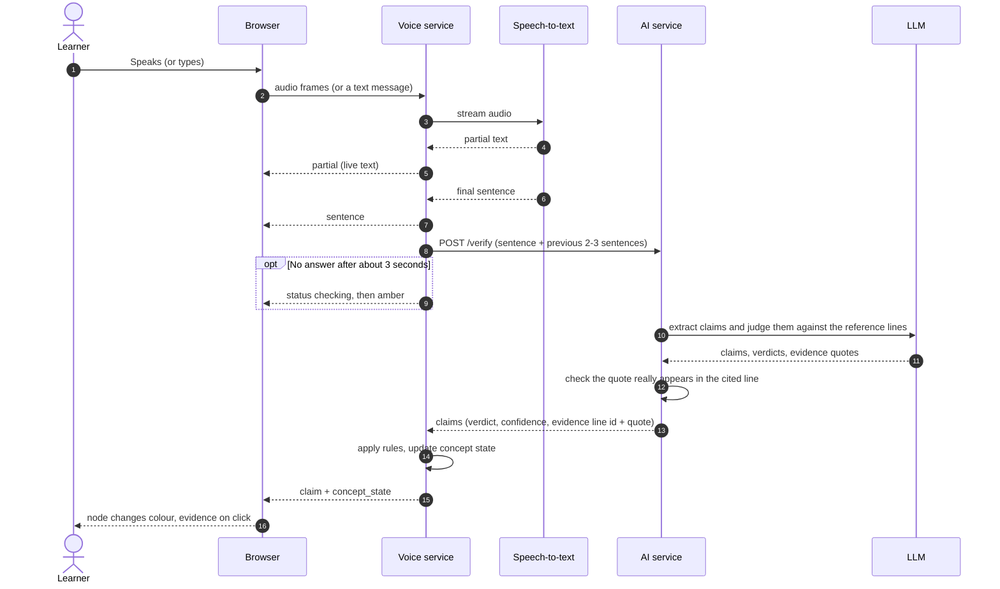
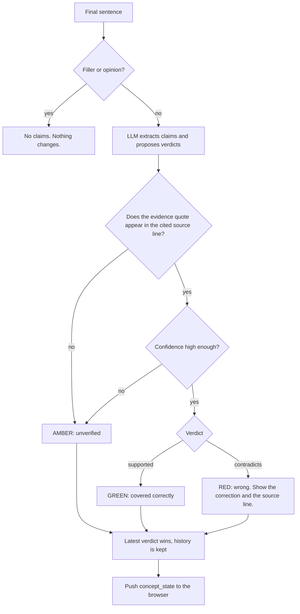
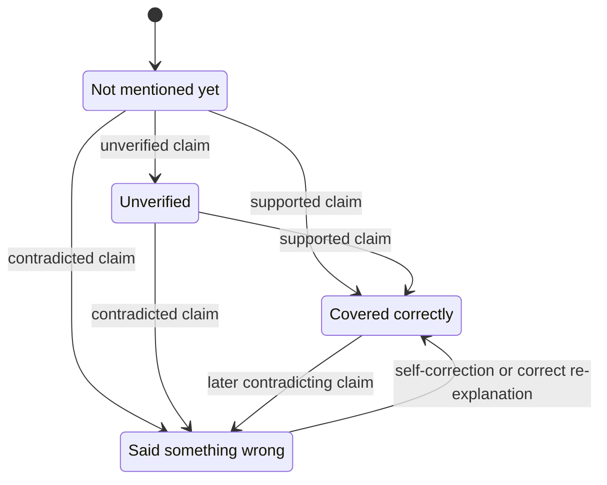
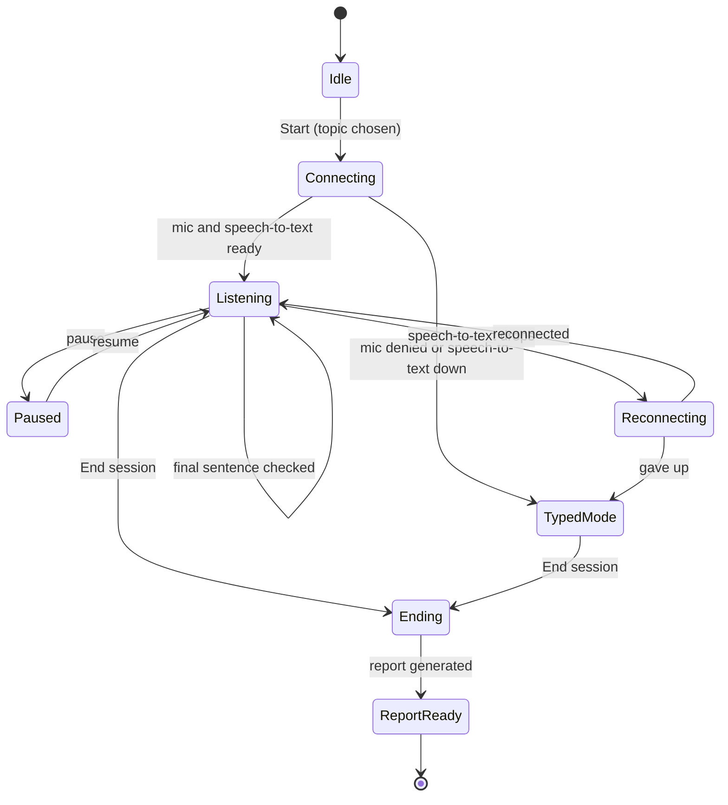
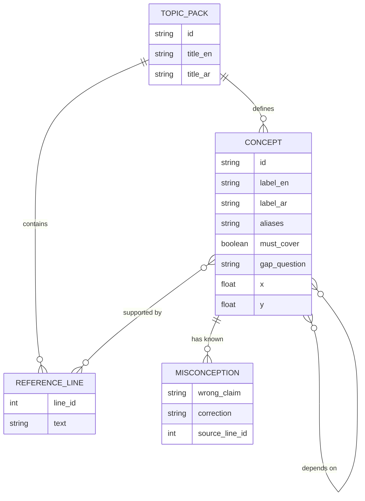
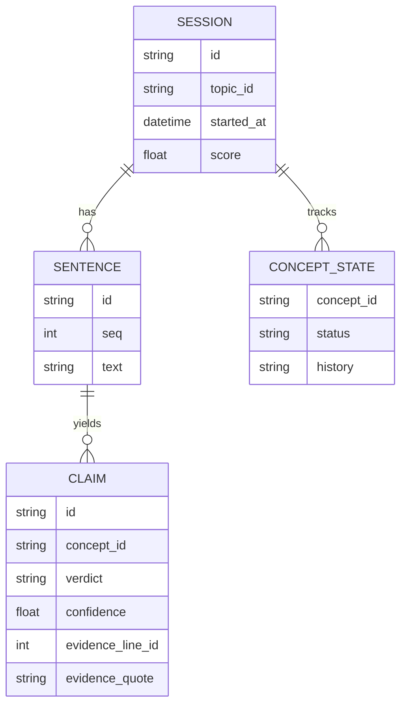
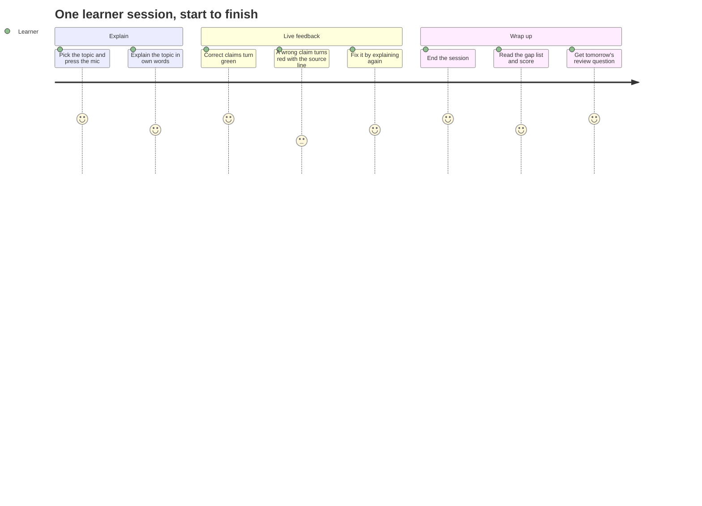
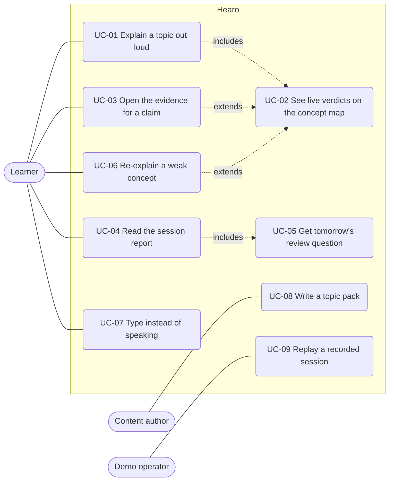

  

> A tool for mastering complex information that **listens instead of talking**. A learner explains a topic out loud in their own words. The AI stays silent and checks every claim against the reference material, live, while a concept map fills in: green = got it, red = said something wrong, grey = skipped.

  

**Track:** Education Technology (study tools / classroom copilots)

**Coding window:** Saturday 10 Oct 11:00 → Sunday 11 Oct 13:00

**Qualifier pitch:** Sunday 13:00 (3 min pitch + 3 min Q&A). Final pitch 17:30 if we qualify.

  

---

  

## 1. The product vision in 30 seconds

  

- A major barrier to mastering complex information, whether you are a student learning a physiological process, a law student reviewing a principle, or a professional studying for a certification, is the gap between *feeling* like you understand something and being able to *explain it accurately*.

- Most AI study tools talk *at* the user. Ours **listens**. The learner does the explaining, and the system identifies what they misunderstood, what they made up, and what essential elements they left out.

- At the end the learner gets a gap list, an explanation score, and a targeted review question. That is what makes it a daily habit.

- **Long-term vision:** a daily-habit tool for any discipline (medicine, law, history, biology, professional training). Loading new reference material is all it takes to change the subject.

- **Hackathon scope:** we prove the core loop with **one polished topic**, so the live end-to-end demo is flawless.

- **Pitch angle:** open with a student in Jordan (school or university). The medicine, law and professional-training vision comes at the end, as the roadmap.

  

**The demo moment:** a user confidently explains the topic but makes a factual error. Within a few seconds that node on the live map turns red, showing the correction and the exact source line from the reference material as proof.

  

---

  

## 2. How it works

  

```

Browser (mic + live UI)  <--WebSocket-->  Voice service  --->  AI service

                                              |                    |

                                       Speech-to-text API      LLM API

                                              |

                                           Storage

```

  

1. The browser streams mic audio to the **voice service**.

2. The voice service sends it to speech-to-text and builds **finished sentences**.

3. For each finished sentence it calls the **AI service**, which returns claims with verdicts and evidence.

4. The voice service applies the rules, updates the concept map state, and pushes live events to the browser.

5. At the end the AI service writes the report (gaps, errors, score, tomorrow's question).

  

**Key design idea: the finished sentence is the narrow waist.** Live mic, a recorded audio file, and typed text all become the same "final sentence" event. Everything after that is identical. This lets us build text-first, replay recordings for the demo fallback, and run our evaluation set through the same path.

  

### Verdict rules (plain code, not the model)

  

- **Evidence-grounded verification:** "supported" or "contradicts" only stands if the evidence quote really appears in the cited source line. Otherwise it drops to **amber** (unverified). The system must never confidently label a claim without evidence.

- Low confidence also becomes amber.

- Per concept, the latest verdict wins, but we keep the history. A self-correction ("wait, actually...") turns the node green and is noted in the report.

- Filler and opinion sentences produce no claims.

- Score = coverage of must-cover concepts x accuracy, shown with its breakdown.

- *Note on subject flexibility:* different disciplines need different kinds of evaluation (historical interpretation vs. factual anatomy, for example). This weekend's version does not solve every edge case. It strictly validates claims against our defined reference text.

  

### Topic pack (the reference material for one topic)

  

This is what lets the product scale to any subject later: swap the reference material and the system adapts. A pack contains: reference lines (numbered, one fact each), concepts (with aliases in both languages, a must-cover flag, supporting lines, dependencies), known misconceptions (the wrong claim phrased the way a student says it, plus the correction), a gap question per concept, and fixed node positions for the map. *Hackathon limit:* keep it small, 8-15 lines and 5-8 concepts.

  

---

  

## 3. Diagrams

  

> The diagrams are [Mermaid](https://mermaid.js.org/). They render automatically on GitHub and in most Markdown previews. If your viewer shows raw code, paste a block into <https://mermaid.live>.

  

### 3.1 System architecture

  

Three deployable pieces: the browser, the voice service (Aya), and the AI service (Faisal). Only the AI service talks to the LLM. Only the voice service talks to speech-to-text.

  



  

### 3.2 What happens to one sentence

  

The full path from the learner's mouth to a coloured node. The `opt` block is the timeout rule: if the AI service takes more than about 3 seconds, the UI shows "checking" and then falls back to amber.

  



  

### 3.3 Verdict rules (the part that is plain code, not the model)

  

This is the "never confidently wrong" guarantee. The model proposes. The code decides.

  



  

### 3.4 Life of one concept node

  

Colours on the map. Per concept, the latest verdict wins, and a self-correction turns a red node green (and is noted in the report).

  



  

### 3.5 Session lifecycle

  

Includes the failure paths. Typed mode is the safety net: it uses the same "final sentence" path as live audio, so the demo never dies when the microphone or speech-to-text does.

  



  

### 3.6 Data model

  

**Topic pack** (the reference material for one topic, authored by hand):

  



  

**Session data** (what SQLite stores):

  



  

### 3.7 Screen layout

  

Reference for Rama and Lana. Judges watch this on a projector, so big fonts and high contrast. The left source panel is optional: if time is short, show only the transcript and the map. When a claim is red or green, the cited reference line is highlighted in the source panel. Colours: green = supported, red = contradicted, amber = unverified, grey = not mentioned.

  

```text

+------------------------------------------------------------------------------------+

| HEARO   Topic: Earth's Seasons     session 02:34     [ EN | AR ]    [ End session ] |

+--------------------+-----------------------------------+---------------------------+

| SOURCE (optional)  | LIVE TRANSCRIPT                   | CONCEPT MAP               |

|                    |                                   |                           |

| Reference lines    | Student: The Earth has an axial   |   [ Axial tilt ] green    |

|  1 ...             |   tilt, so it spins at an angle.  |         |                 |

|  2 ...             |   v Validated: axial tilt         |         v                 |

|  3 ...             |                                   |   [ Hemispheres lean ]    |

|  4 [highlighted]   | Student: ...orbit is highly       |         green             |

|  5 ...             |   elliptical, closer in summer.   |         |        |        |

|                    |   x Contradicts line 4            |         v        v        |

|                    |   [ Re-explain this concept ]     |   [ Sunlight ] [ Day ]    |

|                    |                                   |     grey        grey      |

|                    |                                   |   [ Nearly circular       |

|                    |                                   |     orbit ] RED           |

+--------------------+-----------------------------------+---------------------------+

| (mic)  ~~~ waveform ~~~    [ Type a sentence to test...            ] [ Send ]      |

+------------------------------------------------------------------------------------+

```

  

After "End session", a **Session Report** modal opens: final score with its breakdown (for example 40%, 2 of 5 must-cover concepts), missed concepts, mistakes with corrections ("You said / Correction, Source: line 4"), and tomorrow's review question.

  

### 3.8 Learner journey (the 3-minute demo)

  



  

---

  

## 4. Use cases

  

### 4.1 Use case overview

  



  

| ID | Use case | Actor | Priority |

|---|---|---|---|

| UC-01 | Explain a topic out loud and get silent, live checking | Learner | **Must** |

| UC-02 | See verdicts appear on the transcript and concept map | Learner | **Must** |

| UC-03 | Open the evidence (quote + source line) behind a verdict | Learner | **Must** |

| UC-04 | Read the end-of-session report (score, gaps, mistakes) | Learner | **Must** |

| UC-05 | Get tomorrow's review question | Learner | **Must** (shown in the report) |

| UC-06 | Re-explain one weak concept after a red flag | Learner | Should |

| UC-07 | Type a sentence instead of speaking | Learner, team | **Must** (dev and fallback) |

| UC-08 | Write a topic pack for a new subject | Content author | **Must** (one pack) |

| UC-09 | Replay a recorded session through the same screen | Demo operator | **Must** (fallback) |

  

### 4.2 Primary use cases in detail

  

**UC-01 Explain a topic out loud**

- **Actor:** Learner

- **Before:** A topic pack is loaded. The mic is allowed, or typed mode is on.

- **Main flow:**

  1. The learner picks a topic and presses the mic.

  2. They explain the topic in their own words. The AI stays silent: no questions, no hints.

  3. Each finished sentence is checked against the reference lines.

  4. The transcript line gets a verdict, and the matching map node changes colour.

- **Alternatives:**

  - Filler or opinion ("um, so, I think it's interesting") produces no claims and changes nothing.

  - A claim that cannot be verified, or has low confidence, becomes **amber**, never red.

  - A self-correction ("wait, actually...") turns the node green and is noted in the report.

- **After:** The map shows the current state of every concept.

  

**UC-03 Open the evidence for a claim**

- **Actor:** Learner

- **Main flow:** The learner clicks a green, red or amber claim. The UI shows the exact reference line, the quote that backs the verdict, and, for red claims, the correction. In the optional source panel that line is highlighted.

- **After:** The learner can see *why* the system judged the way it did. This is the trust feature.

  

**UC-04 Read the session report**

- **Actor:** Learner

- **Main flow:** The learner presses "End session". The report shows:

  - the final score with its breakdown (coverage of must-cover concepts x accuracy)

  - missed concepts (the gaps)

  - mistakes and corrections: "You said X. Correction: Y (Source: line N)"

  - strengths, and self-corrections

  - tomorrow's review question

  

**UC-05 Get tomorrow's review question**

- **Actor:** Learner

- **Main flow:** The report ends with one targeted question aimed at the biggest gap or mistake. Example: *"If the Earth's orbit is nearly circular, what actually causes the temperature differences between summer and winter?"*

- **Hackathon scope:** we show the question. A daily score trend is optional (two sample sessions are enough).

  

**UC-06 Re-explain a weak concept** (should have)

- **Actor:** Learner

- **Main flow:** From a red claim the learner presses "Re-explain this concept". The system listens again, focused on that concept only. If the new explanation is supported, the node turns green and the report notes the self-correction.

  

### 4.3 Supporting use cases

  

**UC-07 Type instead of speaking.** A text box sends a typed sentence as a `text` message. It becomes the same "final sentence" event as live speech. Used for development, testing, noisy rooms, and as the fallback when the mic or speech-to-text fails.

  

**UC-08 Write a topic pack.** The content author writes numbered reference lines (one fact each), concepts with aliases in both languages, a must-cover flag, supporting lines and dependencies, known misconceptions phrased the way a student says them, a gap question per concept, and fixed node positions. Limit for this weekend: 8-15 lines and 5-8 concepts. Done when Faisal's service loads it and the checks pass on the test sentences.

  

**UC-09 Replay a recorded session.** The demo operator runs a recording (audio or sentences) through the same path as live input. The UI is identical, and the presenter says clearly that it is a recording. This is the "everything fails on stage" plan.

  

### 4.4 Edge cases and expected behaviour

  

| Situation | Expected behaviour |

|---|---|

| Learner is silent | Nothing happens. No prompts, no hints. |

| Filler or opinion sentence | No claims, no colour change. |

| Claim not covered by the reference material | **Amber** (unverified). Never red. |

| Model quote does not appear in the cited line | Verdict dropped to **amber** by the code. |

| Low model confidence | **Amber.** |

| Learner corrects themselves | Latest verdict wins. Node goes green, correction noted in the report. |

| AI service slower than about 3 seconds | Show "checking", then amber. A late result still lands on the right sentence (sentence id). |

| More than 3 sentences waiting | Maximum 3 `/verify` calls in flight per session. |

| Speech-to-text connection drops | Reconnect automatically. If it fails, switch to typed mode. |

| Mic permission denied | Typed mode, with a clear message. |

| Two people talking, or heavy noise | Check what happens, and tell judges the limit honestly. Use a headset mic for the demo. |

| Arabic and English mixed in one sentence | Must display correctly (right-to-left and left-to-right together) and be checked normally. |

| Learner explains something outside the topic | No claims for the topic, so nothing changes. |

  

### 4.5 Who it is for (personas)

  

These are illustrations for the pitch, not real people.

  

| Who | Situation | Value | When |

|---|---|---|---|

| **School student in Jordan** (pitch opener) | Preparing for an exam on a physics or biology chapter. Rereading feels like understanding. | Finds out within seconds what they can't explain, and gets one question to review tomorrow. | **Demo** |

| **University student** | Learning a process (for example in physiology) with a dense textbook. | Active recall against the real textbook, with page and line as proof. | Demo, then roadmap |

| **Law or medicine student** | Must state principles precisely. | Same loop with a pack written from a trusted source and checked by someone who knows the subject. | Roadmap |

| **Professional studying for a certification** | Limited time, wide syllabus. | Daily explain-and-check habit with a gap list. | Roadmap |

| **Teacher or trainer** | Wants to know what the class gets wrong. | Aggregated common misconceptions across learners. | Roadmap |

  

---

  

## 5. Roles

  

| Person | In plain words | Owns, and first deliverable |

|---|---|---|

 The brain: takes one sentence, checks it against the course material, and says what is right, wrong, or can't be verified, with proof. | **AI service** (FastAPI): `/verify`, `/report`, rules layer, evaluation harness. First: a stub `/verify` returning canned answers within the first hour, so everyone can build against it. Aya must be able to start it. |

| The ears and the messenger: turns mic audio into finished sentences, sends each to the brain, and passes results to the screen live. | **Voice service**: audio capture, speech-to-text, sentence building, sessions, WebSocket events, calling the AI service, and running all processes with one command. First: typed-text mode end to end, then live audio. |

 The live screen the judges watch: transcript on the left, concept map on the right. Starts with pretend messages so it never waits for the backend. If a box turns red when a wrong claim arrives, it works. | **Frontend:** concept map + live transcript. First: the map rendering from fake events. |

 The course material the AI checks against (everyone is waiting on this first), the screen shown at the end, and the slides. | **Report page**, **topic content**, and the **pitch deck** (5 slides max). First: topic content, then the report page from a fake report. |

Testing and support: helps with content and screens, and tries to break the app before the judges do. | Evaluation sentences (correct claims, planted errors, omissions), Arabic review of outputs, demo rehearsal, help wherever someone is stuck. First: test sentences for the first topic. |

  

  

**If the fifth person is strong:** second frontend developer, or prompt and evaluation work alongside Faisal.

**If their level is unknown:** give them bounded work (content, eval sentences, Arabic review, rehearsal) and never the voice or AI service.

  

**Demo roles (decide by Sunday morning):** one presenter and one person driving the demo.

  

---

  

## 6. Contract between the pieces

  

Agree the exact fields at hour 0 and write them here. Do not change them without telling everyone.

  

**Browser to voice service:** `start` (topic id), audio frames, `stop`, and a dev-only `text` message for typed sentences.

**Voice service to browser:** `partial` (live text), `sentence`, `claim`, `concept_state`, `status` (per-stage latency), `report`, `error`.

**Voice service to AI service:**

- `POST /verify`: topic id, sentence id, sentence, previous 2-3 sentences. Returns claims (concept, verdict, confidence, evidence line id + quote).

- `POST /report`: the whole session. Returns score breakdown, gaps, errors, strengths, tomorrow's question.

  

The frontend should be one reducer that turns the event stream into screen state, so a recorded session can be replayed by feeding the same events.

  

**Rules of the pipeline:** only final sentences go to the AI service; at most 3 `/verify` calls in flight per session; results carry the sentence id so late results land in the right place; if a call takes over about 3 seconds, show "checking" then amber.

  

---

  

## 7. Stack (decide the open parts at hour 0)

  

- Built and run in **Replit**. Keys live in Replit Secrets, never in client code.

- **Frontend:** React (Vite or Next.js), Tailwind, React Flow for the concept map.

- **Voice service:** language is Aya's choice. Plain WebSocket to the browser.

- **AI service:** FastAPI.

- **Speech-to-text:** Speechmatics (primary), with Gemini or OpenAI audio input as the fallback. Per their current docs the free plan gives a $100 credit with no card, and 2 concurrent real-time sessions. Confirm in the dashboard. Use a custom vocabulary per topic for English technical terms.

- **LLM:** a fast model per sentence, a stronger one for the concept map and report. Choose by running our evaluation set on 2-3 providers.

- **Storage:** SQLite is enough.

- **Not building:** vector database, accounts/login, text-to-speech, agent frameworks, fine-tuned models.

  

---

  

## 8. Schedule

  

| When | Goal |

|---|---|

| **Sat 11:00-12:00** | Roles, contract written down, speech-to-text test on our recorded voices, Faisal's stub `/verify` running |

| **Sat 12:00-16:00** | Typed text works end to end: sentence in, verdicts out, map changes color. First topic written. |

| **Sat 16:00-20:00** | Live audio integrated, report page, first evaluation run |

| **Sat 20:00** | **Gate:** a full demo works on one topic, even if ugly. If not, cut features now. |

| **Sat 20:00-00:00** | Accuracy fixes, Arabic quality, report polish |

| **Sun 00:00-05:30** | Sleep (in shifts if needed). Tired people ship bugs. |

| **Sun 05:30-09:00** | Polish and record the fallback run |

| **Sun 09:00** | **Feature freeze** |

| **Sun 10:00-11:30** | Final build session: demo-breaking fixes only |

| **Sun 11:30** | **Hard code freeze.** Back up a copy. |

| **Sun 11:30-13:00** | Rehearse at least 3 times with a timer. Q&A drill. Hardware check. |

| **Sun 13:00** | Qualifier pitches |

| **Sun 15:30-17:00** | Finalists announced. Rest, tighten the pitch. Check if code changes are allowed in the 16:00 touches block; assume not. |

| **Sun 17:30** | Final pitch, if we qualify |

  

**Scope**

- **Must have:** live transcript, concept map, report, one polished topic, evaluation numbers, latency overlay, fallback recording.

- **Optional:** one backup topic (only after the Saturday 20:00 gate), a daily score trend (two sample sessions is fine).

- **Cut:** accounts, user-uploaded material, a second UI language, mobile.

  

---

  

## 9. Working agreements

  

- We sit at the same table, so ask out loud. Keep the contract written down anyway.

- **One folder per person.** Don't edit someone else's folder without telling them.

- **Check-in every 3-4 hours, 5 minutes:** what works, what's blocked, what I need.

- **If you are stuck for 15 minutes, ask.** Nobody is expected to know everything.

- **From Sunday 11:30, only the demo laptop uses live speech-to-text** (the free tier allows 2 concurrent sessions). Everyone else uses typed-text mode.

- Make sure the Replit workspace does not time out and that one command starts all three processes (Aya).

- No new features after the freeze. **Faisal and Aya** call the freeze.

- If everything fails on stage: play the fallback recording through the same UI and say clearly that it's a recording.

  

---

  

## 10. Team checklist: what everything needs to do for the app to work

  

**Goal of the whole app:** someone says a wrong claim out loud, a box on the map turns red with the correction within a few seconds, and a report appears at the end.

  

### Everyone (Saturday 11:00)

*Goal: agree the basics so all of us can build at the same time.*

- [ ] Agree the demo topic

- [ ] Write down the messages the pieces send each other (which fields)

- [ ] Run each person's voice sample through speech-to-text

- [ ] Check the API keys work and are saved in Replit Secrets

- [ ] Each person works in their own folder

  

### 1st member: the AI service (the brain)

*Goal: take one sentence, check it against the course material, and say what's right, wrong, or can't be verified, with proof.*

- [ ] A fake version of the brain that gives pretend answers, so others can start building (first hour)

- [ ] Load the topic content

- [ ] Real checking: one AI call per sentence, returning the claims, a verdict, and the source line

- [ ] Verify the quote really appears in that source line, otherwise mark it "can't verify" (amber)

- [ ] Low confidence becomes amber, and filler sentences produce no claims

- [ ] End-of-session report: score, gaps, mistakes, strengths, tomorrow's question

- [ ] Accuracy test with the 30 test sentences, giving real numbers

- [ ] Try 2-3 AI providers and pick the best

- [ ] Make sure Aya can start the service herself

  

### 2nd member: the voice service (the ears and the messenger)

*Goal: turn the mic audio into finished sentences, send each to the brain, and pass the results to the screen live.*

- [ ] Typed-text mode first (type a sentence, get results)

- [ ] Connect speech-to-text, with the topic's special words added

- [ ] Stream the mic audio from the browser

- [ ] Build finished sentences, with the last 2-3 as context

- [ ] Send each to the brain (max 3 at once, give up after about 3 seconds)

- [ ] Update each concept: right means covered, wrong means wrong, latest verdict wins

- [ ] Push results to the screen over a live connection

- [ ] Ask for the report at the end

- [ ] Reconnect if speech-to-text drops, and use push-to-talk

- [ ] Replay mode: run a recording through the same path (our fallback)

- [ ] One command starts everything, and the workspace doesn't time out

  

### 3rd member: the live screen

*Goal: build the screen the judges watch, with the transcript on the left and the concept map on the right. Start with pretend messages so you don't wait for the backend. If a box turns red when a wrong claim arrives, it works.*

- [ ] App set up in Replit, with the map library (React Flow)

- [ ] A "play pretend messages" button

- [ ] One place that handles every incoming message and updates the screen

- [ ] Transcript: live text, colored highlights, evidence on click, "checking..." state

- [ ] Concept map: fixed positions, colors, glow when a box changes

- [ ] Connect to Aya's live connection

- [ ] Start/Stop mic button and a typing box

- [ ] Big fonts and high contrast for the projector; mixed Arabic and English displays correctly

  

### 4th member: course content, report screen, slides

*Goal: write the course material the AI checks against (everyone is waiting on this first), build the screen shown at the end, and make the slides.*

- [ ] Write the topic content (facts, concepts, common mistakes, follow-up questions)

- [ ] Hand it to Faisal

- [ ] Build the report screen from a pretend report

- [ ] Connect it to the real report

- [ ] Write the 30 test sentences (correct, wrong, skipped) with the 5th member

- [ ] Pitch slides, 5 maximum

- [ ] Run timed rehearsals from Sunday 11:30

  

### 5th member: testing and support

*Goal: help the content and the screens, and try to break the app before the judges do.*

- [ ] Help write the test sentences

- [ ] Review the Arabic output

- [ ] Help wherever someone is stuck

- [ ] Try odd inputs: long sentences, silence, two people talking

  

### Making it all work (everyone)

*Goal: the whole demo runs from start to finish, without surprises.*

- [ ] A typed sentence produces a colored claim and a changing map (Saturday 16:00)

- [ ] Live speech works end to end (Saturday 20:00 gate)

- [ ] Full run: wrong claim, red box, end session, report

- [ ] Accuracy numbers collected

- [ ] Fallback recording saved and played through the same screen (labeled as a recording)

- [ ] Tested with a headset mic in a noisy room

- [ ] Backup copy of the working version (Sunday 11:30)

- [ ] Demo laptop ready: mic permission, network, charger, keys, other tabs closed

- [ ] From Sunday 11:30 only the demo laptop uses live speech-to-text

- [ ] Three timed rehearsals and a Q&A drill

  

---

  

## 11. Pitch plan (3 minutes)

  

- **0:00-0:20** The problem and the hook: the illusion of competence. Reading a textbook feels like understanding it; explaining it in your own words shows what you really know.

- **0:20-1:50** Live demo: a user explains our chosen topic, triggers a misconception, the node goes red, the map shows the gaps, and the report generates.

- **1:50-2:30** How it works in one sentence, plus our measured numbers (planted errors caught, false flags per 100 correct claims, latency). Highlight the deterministic evidence check.

- **2:30-3:00** The broad vision: a daily-habit tool that scales to law, medicine and corporate training just by loading new reference packs.

  

**Q&A answers to have ready**

1. *False red flags?* The evidence quote is validated in code; amber when unsure; here are our numbers.

2. *Why not ChatGPT?* Generic chatbots talk *at* you. This listens, forces active recall, and checks you explicitly against source material.

3. *Arabic dialects?* Dialect and code-switching support in the speech-to-text, a custom vocabulary per topic, and honest limits.

4. *Who is it for / money?* Anyone studying complex material (students, professionals). B2C subscriptions first, then institutional licensing. Be ready to also discuss selling to schools and universities.

5. *What's technically hard?* Claim extraction, omission detection, deterministic verification.

6. *Privacy?* Say exactly what we store. The provider's docs say the real-time service doesn't store audio or transcripts.

  

---

  
  
  

---

  

## 13. Decisions

  

**Settled**

- [x] **Product name:** Hearo (working name). Several products and hackathon projects named Hearo exist in hearing-accessibility, but we found no direct education competitor. Fine for the weekend; revisit if we continue.

- [x] **Topic count:** one polished primary topic. A backup pack only after the Saturday 20:00 gate, and only if the main demo already works.

  

**Still open**

- [ ] **The demo topic.** Pick one where: (1) the reference text is short and unambiguous, from a trusted textbook; (2) there is a classic misconception a judge recognizes within two seconds; (3) it is in the Jordanian curriculum. Examples: why we have seasons ("closer to the Sun in summer"), photosynthesis ("plants get their mass from soil"), falling objects ("heavier things fall faster"). Medicine and law are the roadmap, not the main demo, unless the pack is written from a trusted source and checked by someone who knows the subject.

- [ ] Voice service language (Aya).

- [ ] Presenter and demo driver.

- [ ] What the fifth person does once we know their level.

  

---

  

## Appendix: plain-words glossary

  

- **Frontend:** what the user sees and clicks in the browser.

- **Backend:** the hidden programs that do the heavy work (the voice service and the AI service).

- **Event:** a small message the backend sends to the screen, like "a new sentence arrived" or "this concept turned red".

- **Fake (mock) data:** pretend events you write yourself so you can build a screen before the real backend exists.

- **State:** what the screen is currently showing. Each new event changes it.

- **Replit Agent:** the AI helper inside Replit that writes code on request. Ask it for one small thing at a time, give it examples, ask it to explain what it wrote, and tell it which files not to touch.